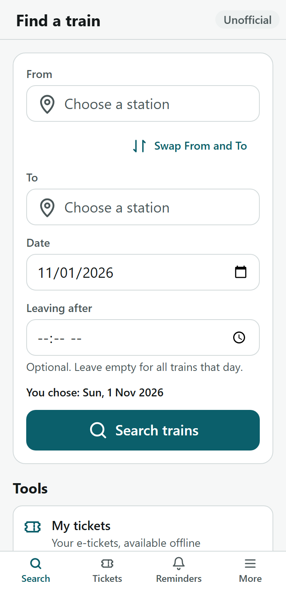
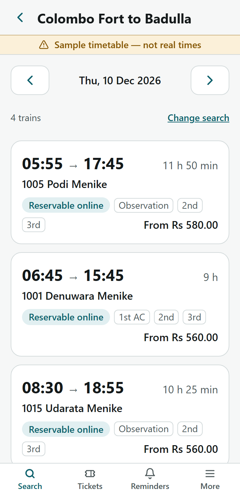
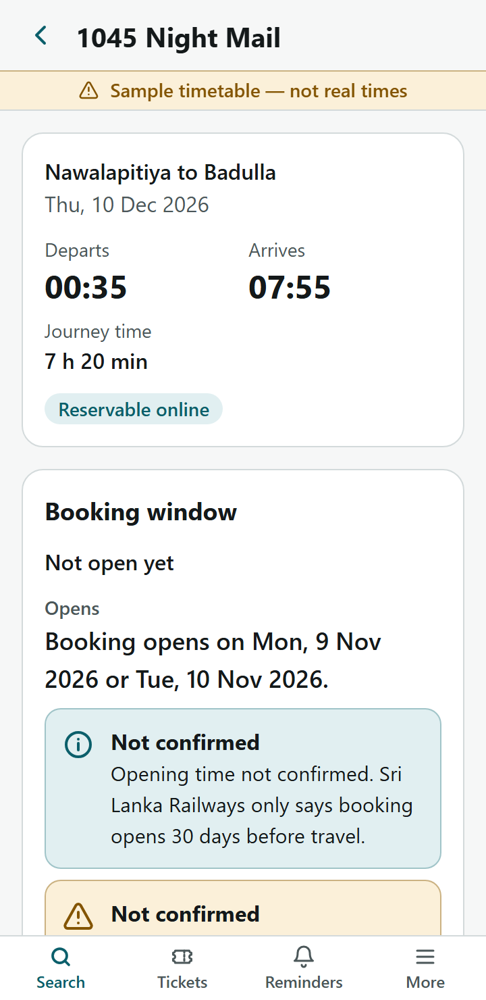
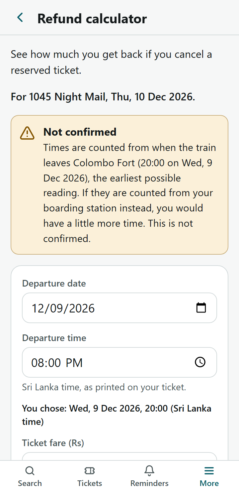
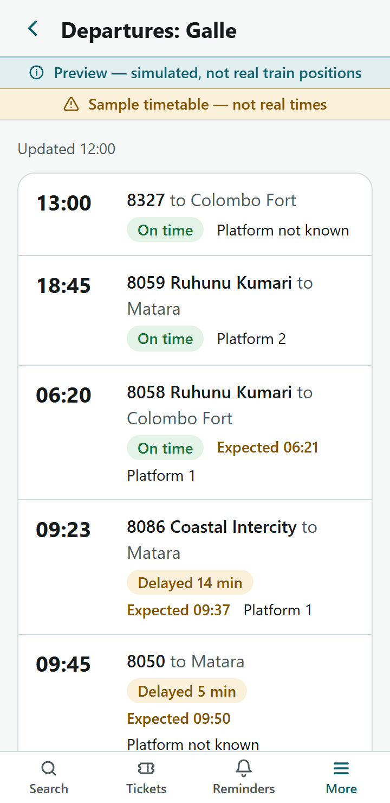
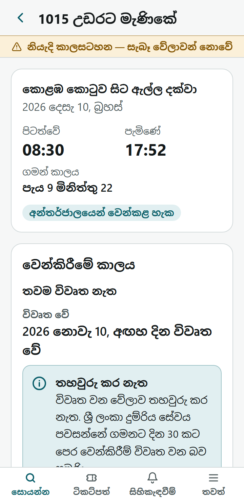

# Dumriya (working name)

An **unofficial** companion web app for Sri Lanka Railways passengers. It does not sell tickets. It helps people find trains, remember booking windows and refund deadlines, and hands off to the official booking sites.

> Not affiliated with or endorsed by Sri Lanka Railways. All timetable, fare, station and live data in this repository is **sample data**.

## At a glance

Dumriya is an installable, offline-capable web app (PWA) for train passengers in Sri Lanka, in English, Sinhala and Tamil. It finds trains and works out when the 30-day booking window opens, including the night-train case where two dates are possible. It counts down refund deadlines, keeps e-tickets on the phone for use with no signal, sets reminders, and hands off to the official booking sites with a look-alike-site warning. Every Sri Lanka Railways rule lives in one tested config file, and where a rule is ambiguous the app picks the reading that gives the passenger the earlier time. It is built for a 360px phone on a slow connection: 129 KB of initial JavaScript, with a 150 KB budget enforced by the build, and it stays usable at 200 % text. This is the UI phase: all data comes from a typed mock API that a Python backend will replace.

**Live demo:** _not deployed yet; the link will be added here._ The demo shows sample data, and says so on every screen.

<table>
  <tr>
    <td align="center"><br>Search</td>
    <td align="center"><br>Results</td>
    <td align="center"><br>Booking window</td>
  </tr>
  <tr>
    <td align="center"><br>Refund calculator</td>
    <td align="center"><br>Station board (preview)</td>
    <td align="center"><br>Sinhala</td>
  </tr>
</table>

Screenshots are taken at 360 × 740 by `npm run screenshots` (fixed date, sample data).

**Tech stack:** React 19, TypeScript (strict), Vite 8, React Router 8, Tailwind CSS 4, i18next. PWA via vite-plugin-pwa (Workbox), IndexedDB via idb-keyval, Leaflet with OpenStreetMap (lazy-loaded). Tests: Vitest with happy-dom and Testing Library, Playwright with axe-core. Self-hosted Noto Sans Sinhala and Tamil fonts. No backend yet.

**Tests:**

```bash
npm run check   # type check + lint + 449 unit tests (about 6 s)
npm run e2e     # 15 Playwright tests on the production build at 360px (about 2 min; first time: npx playwright install chromium)
```

The Playwright tests cover axe-core checks in light and dark themes, layout in all three languages up to 200 % text, the offline ticket wallet, alerts, maps (with faked tiles) and font loading. All of them run under the production Content-Security-Policy.

**More:** [DECISIONS.md](DECISIONS.md) (choices someone might otherwise "fix" by mistake) · [REVIEW.md](REVIEW.md) (open questions for the Sinhala and Tamil reviewers) · [HANDOVER.md](HANDOVER.md) (everything still marked "Not confirmed", "Sample" or TODO).

## Run it

```bash
npm install
npm run dev          # http://localhost:5173
npm run check        # type check + lint + unit tests
npm run e2e          # Playwright tests (first time: npx playwright install chromium)
npm run build && npm run preview   # production build with the service worker and the deploy headers
npm run screenshots  # regenerate docs/screenshots
```

`npm run build` prints the initial JS size and **fails if it exceeds 150 KB gzipped** (see `build/bundleBudget.ts`).

## Data layer and the mock-API swap point

**Sample-data bar:** while the mock is active, `IS_SAMPLE_DATA` (exported by `src/api/index.ts`) is `true` and every screen with train data shows a permanent "Sample timetable — not real times" bar in its header. It disappears automatically when `api` points at the real implementation.

Screens only ever import from `src/api` (enforced by ESLint: importing `src/mocks/*.json` or `src/api/mock` from a screen is a lint error).

```
src/api/contract.ts   DumriyaApi interface – the contract the backend must meet
src/api/index.ts      ← SWAP POINT: `const api: DumriyaApi = mockApi;`
src/api/mock/         mock implementation (fake 150–450 ms delay, deep-copied results)
src/mocks/*.json      SAMPLE DATA – each file carries a "_notice" saying so
```

To connect the FastAPI backend: add `src/api/http.ts` exporting an object that implements `DumriyaApi`, then change the one line in `src/api/index.ts`. The tests in `src/api/api.test.ts` describe the expected behaviour (direction, running days, night trains crossing midnight, time filter) and can be pointed at the real implementation.

All times are handled in **Asia/Colombo (+05:30, no DST)** regardless of the phone's time zone (`src/lib/time.ts`).

## Sri Lanka Railways rules hard-coded in this app

> ⚠️ **These rules were taken from public SLR / seat-reservation FAQ information and must be re-checked against the official FAQ before every release.** They all live in [`src/config/policy.ts`](src/config/policy.ts); keep this list in sync with that file.

| Rule | Value | Constant |
|---|---|---|
| Reservations open before the date of travel | 30 calendar days (Asia/Colombo date) | `BOOKING_WINDOW_DAYS` |
| "Date of travel" for the 30-day window | **Assumed, conservative, verify with SLR.** The date the train leaves its **origin**. If the passenger boards on a later calendar date (night train after midnight), both possible opening dates are shown and reminders use the earlier one | `BOOKING_WINDOW_DAYS` |
| Time of day booking opens | **Not confirmed** – `null`, so the UI shows the date only with a "time not confirmed" note | `BOOKING_OPEN_TIME` |
| Online booking closes before departure | 2 hours | `BOOKING_CLOSE_HOURS_BEFORE` |
| Which departure the 2 hours count from | **Assumed, conservative, verify with SLR.** The train's **origin** station departure; UI says "may be later from your station". Boarding-station rule available as an option, off by default | `BOOKING_CLOSE_USE_BOARDING_STATION` |
| Max seats per online booking | 5 | `MAX_SEATS_PER_BOOKING` |
| Return trip with a different passenger count or boarding station | needs a separate booking. **Assumed, verify with SLR:** "different boarding station" means the return does not start where the outward trip ended | `planBookings` in `src/lib/booking.ts` |
| Online convenience fee | 5 % of fare | `CONVENIENCE_FEE_RATE` |
| Payment methods | Card or LANKAQR only | `PAYMENT_METHODS` |
| Valid email required | e-ticket is only sent by email | `EMAIL_REQUIRED_FOR_ETICKET` |
| ID per passenger | NIC or passport number for every passenger | `ID_REQUIRED_PER_PASSENGER` |
| Transferability | Tickets are non-transferable; ID checked at the gate | `TICKETS_TRANSFERABLE` |
| ID mismatch penalty | Double fare | `ID_MISMATCH_PENALTY_FARE_MULTIPLIER` |
| Refund, more than 168 h before departure | 75 % of fare | `REFUND_TIERS` |
| Refund, 168 h or less and more than 48 h | 50 % of fare | `REFUND_TIERS` |
| Refund, 48 h or less | 0 % | `REFUND_FALLBACK_PERCENT` |
| Which departure refund deadlines count from | **Assumed, conservative, verify with SLR.** The train's **origin** departure (earliest). The calculator says so in words when the passenger boards later on the route | `REFUND_COUNT_FROM_BOARDING_STATION` |
| Refund boundaries | Exactly on a boundary → the **lower** refund | `REFUND_TIERS` |
| Service charge | Never refunded | `SERVICE_CHARGE_REFUNDABLE` |
| How refunds are done | In person at a station counter, with an NIC/passport copy | `REFUND_IN_PERSON_ONLY`, `REFUND_DOCUMENTS` |
| Temporary warrant reservation expiry | 7 days after booking **or** 48 h before the journey, whichever is first; must be confirmed at a station | `WARRANT_EXPIRES_DAYS_AFTER_BOOKING`, `WARRANT_EXPIRES_HOURS_BEFORE_JOURNEY` |
| Pravesha commuter tickets | Can be bought up to 7 days in advance | `PRAVESHA_ADVANCE_DAYS` |
| Pravesha tickets per order | **Assumed — verify with SLR** (source: Sunday Observer, Sep 2024). At most 5 per order, return tickets included; the UI says it is not confirmed | `PRAVESHA_MAX_TICKETS_PER_ORDER` |
| Payment dispute | Official site → Contact Us → dispute type "Payment issue" | `DISPUTE_TYPE_LABEL` |

**Ambiguity rule:** where SLR's wording is ambiguous, the app picks the interpretation that gives the user the **earlier** time, so nobody misses a window. Rows marked "assumed, conservative" above are such interpretations and must be confirmed with SLR.

## Official links

Only these destinations are used for booking (`src/config/links.ts`):
- Reserved seats: `https://seatreservation.railway.gov.lk`
- Commuter tickets (Pravesha): `https://www.pravesha.lk` (`PRAVESHA_URL`; sources: Ada Derana Aug 2024, Newswire Sep 2026; verified by the project owner). If it is ever set back to `null`, the Pravesha button is replaced by a non-clickable "Pravesha: link coming soon" and users are pointed to the station counter, so there is never a broken or guessed link.

Every outbound booking link goes through `isOfficialUrl()` (https and an exact official host); anything else is not rendered. The booking helper shows a "You are leaving Dumriya" notice with a look-alike-site warning and the exact host to check in the address bar.

## Map tiles

Tile URL and attribution are in `src/config/app.ts` (`MAP_TILE_URL`, `MAP_TILE_ATTRIBUTION`).

> ⚠️ **Before any public launch we must switch to a tile provider that allows our usage.** The current URL is the OpenStreetMap Foundation's standard tile server. Its [tile usage policy](https://operations.osmfoundation.org/policies/tiles/) allows only light use: it is run by volunteers on donated servers, offers no service guarantee, forbids bulk downloading and prefetching, and may block apps that cause heavy traffic. A public app used by many passengers would be heavy use. Options: a commercial tile provider with a plan that covers our traffic, or self-hosted tiles built from OSM data. Whichever we choose, the attribution must stay visible.

**How tiles are cached** (`build/runtimeCaching.ts`, tested in `build/runtimeCaching.test.ts`):
- Only tiles the user has already viewed are cached. Tiles are never prefetched: they are not in the service worker's precache list, and no code fetches tiles ahead of time.
- **Network first:** while online, tile requests go through the browser's normal HTTP cache, so the tile server's `Cache-Control` / `Expires` headers decide freshness. The service worker's copy is only an offline fallback.
- At most 300 tiles, each kept 7 days. The tile cache is dropped first if the phone runs low on space, before anything else.
- Tiles are requested with CORS, and only real `200` responses are cached. Opaque responses would each count as about 7 MB of the site's storage quota in Chrome and could crowd out saved tickets.

## Privacy: payment dispute helper

`/dispute` collects name, mobile, location, payment date/time, reference number, last 4 card digits and email **only in React component state**. It never writes them to IndexedDB, localStorage, sessionStorage, the URL or history state, and sends nothing over the network (tested: storage snapshots, IndexedDB, router location, fetch/XHR/sendBeacon/WebSocket spies). The form clears when the user leaves the screen or on `pagehide`, and autofill is off. The card field refuses any input with more than 4 digits (it never truncates a pasted card number). "Copy all" puts an English text block on the clipboard; the only link is to the official reservation site, for Contact Us → "Payment issue".

## Stations and map

- `/stations`: searchable list (English, Sinhala, Tamil names and codes) with the lines each station serves, and a List / Map switch. `/stations/:id`: lines, facility flags, the next 5 departures (sample timetable), Directions, Show on map, Find trains from here.
- **Facility flags are sample data** (`reservationCounter`, `mTicketing`, `praveshaVerification` in `src/mocks/stations.json`) and are labelled "Sample — not confirmed" on screen.
- **Map:** Leaflet is imported only by `src/features/stations/StationMap.tsx` (a guard test enforces this), which is lazy-loaded when the Map view opens: about 44 KB gzipped JS + 6 KB CSS, outside the initial bundle. Tile URL and attribution come from `MAP_TILE_URL` / `MAP_TILE_ATTRIBUTION` in `src/config/app.ts`; the attribution control is always on, and a Playwright test checks it is visible and not covered by the bottom navigation. Markers are circle markers (no image assets); the station list is the accessible alternative to the map.
- **Near me:** the browser is asked for location only when the user taps "Near me". The position stays in component state for sorting: it is never put in the URL, storage or any request. Refused, unavailable and unsupported each get a plain-words message, and the list keeps working.
- **Directions** open Google Maps with the station's coordinates through `ExternalLink`.
- **Tests never use the real tile server:** the Playwright map tests serve a blank tile for every tile request and block the service worker, because Playwright cannot intercept requests the service worker makes itself.

## Preview screens (simulated)

Every preview screen shows a permanent **"Preview — simulated, not real train positions"** bar (`PageHeader preview`). It is separate from the sample-data bar and stays even with a real timetable API, until a live feed exists.

- **Live map** (`/train/:id/live?date=`): a simulated train marker moves along the line between stops (deterministic per train and date), refreshing every 15 s (`LIVE_REFRESH_MS`). The screen shows "Last updated N min ago", the next stop scheduled vs predicted, and a status badge (on time / delayed / cancelled; status colours only). **Text alternative:** a table of every stop with scheduled, predicted and passed/next.
- **"I'm on this train":** explains exactly what a future version would share (approximate location rounded to ~100 m, train number and time, every 60 s while sharing and the app is open) and when it would stop (end of the journey, at most 6 hours, Stop, or closing the app). The design values are in `src/config/app.ts`. **The preview never calls the geolocation API and sends nothing** (tested); "Start demo" only changes what the dialog shows.
- **Follow a train:** "delayed more than N min" (`FOLLOW_DELAY_OPTIONS`) and "cancelled" toggles. The API's `getFollowEvents()` returns simulated events (first stop where the delay is more than N; cancellation announced 2 h before the origin departure), stored as a `train-follow` reminder and fired by the Stage 7 alert engine.
- **Station board** (`/stations/:id/board`): next 10 departures, scheduled vs expected, status, and platform or "Platform not known"; refreshes every minute.
- Leaflet is one shared lazy chunk (about 43 KB gzipped JS + 6 KB CSS) used by both map screens; only `StationMap.tsx` and `LiveTrainMap.tsx` may import it.

## Ticket wallet (offline)

- Tickets live only in IndexedDB on the phone (`dumriya-tickets`); the file is stored as raw bytes (`ArrayBuffer`, up to `MAX_TICKET_FILE_BYTES` = 10 MB, PDF or image) and is **never read or parsed**. The user types or confirms every detail.
- Refund countdowns use the tested `refundQuote()`. Deadlines count from the **earlier** of the departure the user entered and the train's origin departure (when the train is in the timetable); this is worked out when the ticket is saved, so countdowns work offline.
- After the first save the app asks the browser for persistent storage (`navigator.storage.persist()`), and the wallet says plainly whether the browser agreed.
- Storage failures are explained in words: "blocked" (private browsing, blocked site data) vs "full" (`QuotaExceededError`).
- Settings → "Delete all my data" clears tickets, reminders and every local preference.
- `e2e/wallet-offline.spec.ts` saves a ticket, cuts the network, reloads the app from the service worker and opens the ticket.

## External links

Every link that opens a new tab goes through `src/components/ExternalLink.tsx`, which always sets `rel="noopener noreferrer"`. A test fails if any other source file uses `target="_blank"` (`build/source-guards.test.ts`, which reads `src/` from disk at run time so Vitest's on-disk module cache can never hide a new file), and another renders each screen with outbound links and checks every `target=_blank` link.

## About page, licences and version

- **About** (`/settings/about`): says plainly that Dumriya is unofficial and not connected to Sri Lanka Railways, and links only to the two official sites. It also has a sample-data notice (while `IS_SAMPLE_DATA`), a privacy summary, data credits (OpenStreetMap / ODbL), the rules disclaimer, open-source licences, and the version, build date and feedback link.
- **Privacy summary is deliberately exact:** Dumriya has no server and sends none of the user's data. It does say that the phone contacts the map tile server (only when the map is open), and Google Maps or the official sites when their links are tapped, and that those see the phone's internet address like any website.
- **Rules date:** `POLICY_INFO_AS_OF` in `src/config/policy.ts` (currently 2026-10-27) is the date the rules were compiled from public SLR information. Update it whenever the rules are re-checked.
- **Licences are generated, not hand-written:** `build/licenses.ts` walks the production dependency tree in `node_modules` (plus `workbox-window`, which is bundled) and serves it as `virtual:dumriya-licenses`. Developer-only tools are excluded. The Noto Sans Sinhala / Tamil fonts are bundled from `@fontsource` (SIL OFL 1.1), so they appear in the list too.
- **Version and build date** come from `package.json` and the build time (`__APP_VERSION__`, `__BUILD_DATE__`).
- **Feedback:** `FEEDBACK_URL` in `src/config/app.ts` is the project's GitHub issues page. If it is set back to `null`, About shows "Feedback link coming soon."
- **Settings** shows storage used, the browser's storage estimate and whether the browser agreed to keep the data, next to "Delete all my data". When the data isn't protected, it offers "Ask the browser to keep my data".

## Tests

- `npm test` runs Vitest with **happy-dom** (about 6 s for the full suite on the development machine; it was about 20 s with jsdom and real keystroke delays under the same load).
- Use `setupUser()` from `src/test/user.ts` instead of `userEvent.setup()`: it types with no delay between keys, so tests never wait on real time and a frozen `vi.setSystemTime` stays exact. `fakeClipboard()` gives an in-memory clipboard.
- Any `console.error` (including React act warnings) fails the test (`src/test/setup.ts`).

**Playwright** (`npm run e2e`) builds the app and runs against `vite preview` on a 360 × 740 phone:

- Every screen is listed once in `e2e/support.ts` (`SCREENS`), with the dialogs and error states to open on it. The accessibility, layout and longest-strings tests all walk this list, so a new screen added there is covered by all three.
- Specs import `test` from `e2e/support.ts`. It fails any test that triggers a Content-Security-Policy violation, because `vite preview` serves the same headers as the deployed demo (`public/_headers`, read by `build/headers.ts`).
- `openScreen()` waits until the mock API has answered: its fake delay is a timer, so "network idle" alone would check half-loaded screens. The mock counts its pending calls in `globalThis.__dumriyaMockPending`; this goes away with the real API.
- The overflow check compares page width with the phone's 360px, not `window.innerWidth`. A mobile browser zooms out when a page is too wide, and `innerWidth` grows with it, which used to hide overflow.
- Map tiles are always faked (`fakeTiles()`) with the service worker blocked, so tests never touch the real tile server.

## Accessibility

- **axe-core** (`e2e/a11y.spec.ts`) scans every screen, plus the reminder sheet, the "I'm on this train" demo, the delete-all dialog, form errors and the map view, in **light and dark** themes. It runs every axe rule (WCAG 2.0–2.2 A/AA plus best practices) and fails on any **serious or critical** issue. The same test checks that the sample-data and preview bars are visible on every screen that needs them.
- **Longest strings** (`e2e/longest-strings.spec.ts`): Sinhala and Tamil at **200 % text** at 360px, on every screen and state, fail on horizontal overflow. To prove the long text really was on screen, it also checks that the 20 longest strings the sample data can show actually appeared. `e2e/layout.spec.ts` covers English at 100 % and 200 %, and Sinhala and Tamil at 100 %.
- **Large text rules** (found by these tests): the header stays sticky, and the tab bar stays fixed, only while each takes a small part of the screen height (30 % and 20 %, `useFitsOnScreen`). Past that they scroll with the page, so they never cover the content. Single-column grids cannot grow wider than the screen, and a word too long for its line breaks rather than widening the page (`src/styles/index.css`). The stop list and the date switcher on Results stack vertically when narrow (container queries).
- **Contrast** of the status colours and banners is computed from the CSS tokens and tested in `build/contrast.test.ts` (WCAG AA is 4.5:1 for this text size):

| Text | Tokens | Light | Dark |
|---|---|---|---|
| On time badge | `ok` on `ok-soft` | 5.34:1 | 7.31:1 |
| Delayed badge | `warn` on `warn-soft` | 5.74:1 | 7.58:1 |
| Cancelled badge | `danger` on `danger-soft` | 5.75:1 | 7.21:1 |
| On time / delayed / cancelled text on a card | `ok` / `warn` / `danger` on `surface` | 6.15 / 6.50 / 6.57:1 | 8.73 / 9.21 / 7.70:1 |
| On time / delayed / cancelled text on the page | `ok` / `warn` / `danger` on `bg` | 5.73 / 6.05 / 6.13:1 | 9.56 / 10.09 / 8.43:1 |
| Sample-data banner | `warn` on `warn-soft` | 5.74:1 | 7.58:1 |
| Preview banner | `accent` on `accent-soft` | 6.22:1 | 6.34:1 |

All pass AA in both themes. The light-theme badges and banners do not reach AAA (7:1). Status is never shown by colour alone: every badge has its words.

## Deploying the demo (Cloudflare Pages)

**Why Cloudflare Pages** (over Netlify and Vercel):

- **Close to the users:** Cloudflare has had a data centre in Colombo since 2017, so the app and its updates load from inside Sri Lanka.
- **No usage cliff:** the free plan has no bandwidth limit for static sites. Netlify's free plan now runs on 300 credits a month, and when they run out **every site is paused** until the next month; each deploy and each GB of traffic costs credits. Vercel's free Hobby plan is for **non-commercial personal use only**, which may not fit a passenger app later.
- **Needs nothing special:** with no `404.html` in the build, Pages serves `index.html` for any unknown path, so deep links like `/stations/kandy` work. It reads our headers from `_headers`, and every site gets HTTPS on `*.pages.dev` automatically. The service worker needs HTTPS.

**Files:**

- `public/_headers`, copied into `dist/`: a strict Content-Security-Policy (scripts, styles and fonts from our own origin only; images and the service worker's tile fetches also from the map tile server), `X-Robots-Tag: noindex` (a sample-data demo should not show up in search results), no framing, and long caching for the hashed files in `/assets/`. `npm run preview` and every Playwright test use the same file.
- `.node-version` pins Node 24.18.0, the version the tests run on. The Pages build image defaults to Node 22, and `engine-strict` in `.npmrc` would fail the install on anything below 22.22.0.

**Steps** (about 10 minutes; Cloudflare's menu names may differ slightly):

1. Create a free account at [dash.cloudflare.com](https://dash.cloudflare.com/sign-up).
2. Go to **Workers & Pages → Create application → Pages → Connect to Git**. Choose the **Pages** option; Cloudflare also offers Workers, which this static app does not need.
3. Connect GitHub and pick the **Dumriya** repository. Production branch: `main`.
4. Build settings:
   - Framework preset: **None**
   - Build command: `npm run build`
   - Build output directory: `dist`
   - Root directory and environment variables: leave empty (`.node-version` sets Node).
5. **Save and Deploy.** The first build takes a few minutes. The site is then at `https://<project-name>.pages.dev`; name the project `dumriya` for `dumriya.pages.dev` if it is free.
6. Check the live site on a phone:
   - Results and Train screens show **"Sample timetable — not real times"**; Live map and Station board also show **"Preview — simulated, not real train positions"**.
   - Reload on a deep link (e.g. `/stations/kandy`): the screen opens, not a 404.
   - The map loads tiles and shows the OpenStreetMap attribution.
   - Save a ticket, turn on airplane mode, reopen the app: the ticket opens.
   - Optional: in desktop Chrome DevTools → Network → the document, the response headers include `content-security-policy` and `x-robots-tag: noindex`.
7. Replace the "Live demo" line at the top of this README with the URL.

After that, every push to `main` redeploys. Pushes to other branches get their own preview URLs, which also send `noindex`.

**The banners cannot be lost in deployment:** the sample-data bar follows `IS_SAMPLE_DATA`, which is `true` as long as `src/api/index.ts` uses the mock, and the preview bar is always on for preview screens. Neither depends on any environment variable. The deployed files are the same production build the Playwright tests check, and those tests fail if a bar is missing.

**Map tiles:** light demo traffic is within the OpenStreetMap tile policy; a public launch is not (see "Map tiles" below).

## Reminders and alerts

**How alerts are delivered (no push server yet):** reminders are stored on the phone (IndexedDB). While Dumriya is open and on screen, a scheduler checks every 30 s (`REMINDER_CHECK_INTERVAL_MS`), when the app comes back to the foreground, and whenever reminders change. Browsers throttle or pause timers in background tabs (especially on phones), so **alerts can be late or only appear when the user reopens Dumriya**; the app says exactly that and recommends "Add to calendar" for exact timing. Each due alert is shown **once**: as a phone notification if the user allowed it (through the service worker, which Android Chrome requires), and always as a banner inside the app; alerts that came due while the app was in the background or closed are labelled with when they were due. Tapping a notification opens the Reminders screen (`public/sw-notifications.js`).

**Permission:** the browser prompt only appears after the user taps "Turn on alerts". If alerts are denied or unsupported, the screen says what still works (in-app banners, calendar). Headless Chromium always reports notifications as denied, so the Playwright test checks the in-app alert.

| Reminder | Alerts | Constant |
|---|---|---|
| Warrant reservation (Reminders → "Add a warrant reminder") | 24 h and 2 h before it expires (earlier of booking + 7 days and journey − 48 h); if both are past, one at the expiry | `WARRANT_ALERT_HOURS_BEFORE` |
| Refund drops (ticket → "Remind me before the refund drops") | 24 h before each future drop to a lower tier (or about a minute from now if the drop is less than 24 h away) | `REFUND_ALERT_HOURS_BEFORE` |
| Booking opens (train → "Remind me when booking opens") | see below | |

### Booking-opens reminders

While `BOOKING_OPEN_TIME` is `null`, a "Remind me when booking opens" reminder uses these alerts (all in [`src/config/app.ts`](src/config/app.ts)):

| Alert | Default | Constant |
|---|---|---|
| Heads-up the evening **before** the earliest possible opening date: "Booking may open tomorrow for &lt;train&gt; on &lt;date&gt;. Exact time not confirmed." | 20:00, always on | `BOOKING_HEADS_UP_TIME` |
| Optional alert at the start of the opening date (toggle: "Also alert me at midnight (seats on popular trains can sell out within minutes)") | 00:00, **off** | `BOOKING_MIDNIGHT_ALERT_TIME`, `BOOKING_MIDNIGHT_ALERT_DEFAULT` |

When `BOOKING_OPEN_TIME` is set, a single alert fires at the exact opening time instead. Alerts already in the past are dropped. The `.ics` calendar export contains one event per alert at exactly the same times (tested in `src/lib/reminders.test.ts`).

## Dates and times

- Times are always `HH:mm` (24 h, Asia/Colombo) in every language, matching tickets and timetables.
- Dates are built from month/weekday names in the translation files (`format.date`, `format.months`, `format.weekdaysShort`), **not** from the browser's `Intl` data: many Android WebViews ship without Sinhala/Tamil locale data and silently show US English. The Sinhala date order (`{{year}} {{month}} {{day}}, {{weekday}}`) needs native review.

## Translations

Open questions for the Sinhala and Tamil reviewers are in [REVIEW.md](REVIEW.md).

English (`src/i18n/en.ts`) is final. Sinhala (`si.ts`) and Tamil (`ta.ts`) are drafts: every line carries a `// TODO(review-si)` / `// TODO(review-ta)` comment for a native speaker to remove once checked. The type checker enforces identical keys; tests fail if any string *value* contains "TODO". Sinhala/Tamil station names in `src/mocks/stations.json` also need review.
